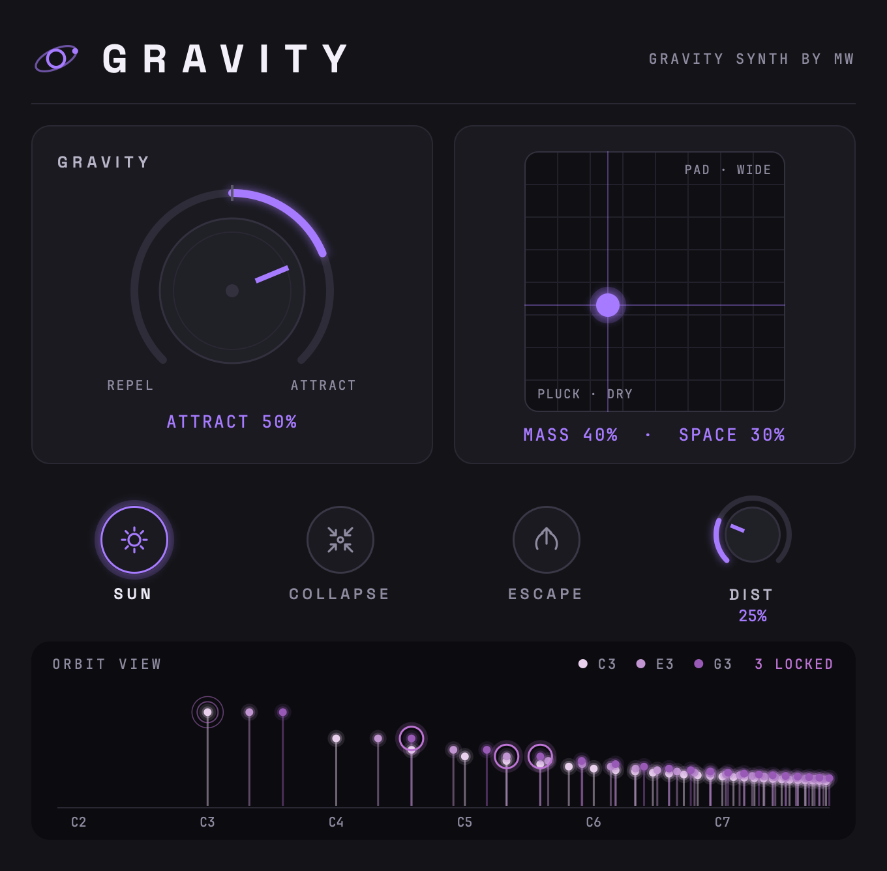

# Gravity

A synth where notes attract each other (macOS, VST3 and AU, Apple Silicon and Intel). Every
note is a cloud of 32 partials, and partials of different notes pull on each other like masses,
so held chords drift, beat and settle into pure tuning.

<p align="center"></p>

## Download

Get the latest version under **[Releases](../../releases)**: `Gravity-v0.1-macOS.zip`
(plugins, install guide and audio examples).

## Install

1. Copy `Gravity.vst3` to `~/Library/Audio/Plug-Ins/VST3/` and `Gravity.component` to
   `~/Library/Audio/Plug-Ins/Components/`.
2. Gravity is not notarized by Apple, so macOS blocks it at first. Run this once in Terminal:
   ```
   xattr -dr com.apple.quarantine ~/Library/Audio/Plug-Ins/VST3/Gravity.vst3 ~/Library/Audio/Plug-Ins/Components/Gravity.component
   ```
3. Restart your DAW and rescan plugins. Gravity is an instrument from manufacturer "MW".

## Controls

| Control | What it does |
|---|---|
| **Gravity** | Right attracts (chords pull into tune), left repels (beating), centre is off. |
| **Mass** (pad, vertical) | Light = plucks and bass, heavy = slow, drifting pads. |
| **Space** (pad, horizontal) | Stereo orbit of the partials plus reverb. |
| **Sun** | The lowest held note anchors; other notes glide into pure tuning with it. |
| **Collapse** | Released notes slide into the notes still held. |
| **Escape** | Hard hits fling partials upward. |
| **Dist** | Saturation before the reverb. |

The Orbit View at the bottom shows every partial live, with rings where partials have locked.

## Licence

Built with JUCE. Third-party licences are listed in [THIRD-PARTY-NOTICES.txt](THIRD-PARTY-NOTICES.txt).
